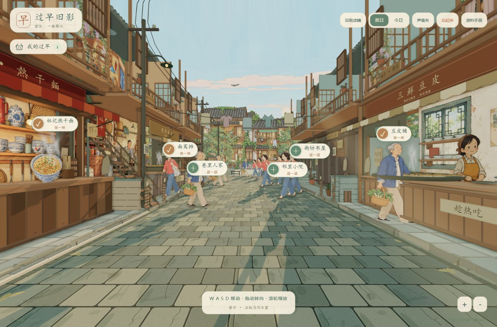

# 过早旧影 · 武汉老街 v9

在淡彩绘本老街里，以第一人称走近武汉早餐铺，看看整条街的昔日与今日。

**[直接在线体验](https://geming-eng.github.io/wuhan-breakfast-freewalk/)** · **[v9 实现与交接说明](docs/street/v9-first-person.md)**

## 操作

- 电脑：WASD / 方向键移动，拖动画面转向，滚轮缩放。
- 手机：左下摇杆移动，拖动街景转向，右下加减按钮缩放。
- 点每家店铺前的交互按钮可沿街走近；“继续走走”从当前位置自由行动。
- “昔日 / 今日”同步改变六栋建筑、三家早餐铺、行人、石板路和街道陈设。
- 看见喜欢的早餐可以收进食篮，刷新保留，还可下载自己的过早记录。




## 本版内容

18 位放大后的行人、统一眼高的自由移动、热干面/豆皮/面窝三处餐铺的两年代变化、三栋可观察的街坊门面、三个生活角落，以及具有裂缝、苔痕、磨损与修补的石板路。保留绘本纸景翻墙、晨光、热气和食篮。

43 项单元测试通过，TypeScript 与生产构建通过。已检查桌面 1366×900、手机尺寸 390×844 的界面和操作；实体手机帧率与多指手势尚未实测。具体证据见 [验收记录](docs/street/verification-v9/checks.json)。

## 本地运行

需要 Node.js 22.18 或更新版本。

```sh
npm ci
npm test
npm run build
npm run preview
```

打开终端中的地址即可。源码不包含 node_modules；GitHub Pages 的 gh-pages 分支是可直接部署的构建文件。若下载完整预览包，双击 Start-Tour.cmd 即可启动包内 dist，不需要安装依赖。不要直接双击 dist/index.html。

默认 `/` 即本版。历史原故事位于 `?sample=classic`，林记样板位于 `?sample=noodle&art=storybook`，开发观察入口位于 `?sample=street`。

## 来源

基于 [Zhu4143/wuhan-breakfast-storybook-handoff](https://github.com/Zhu4143/wuhan-breakfast-storybook-handoff) 的公开 v7 交接版（163afdba）继续开发，保留原项目资料和来源记录。此仓库是独立公开版本。

街巷、店主与对白为虚构艺术创作，文化介绍有资料出处。AI 图像提示词与素材记录保存在 docs/street/ 中。本项目没有后端、账号或支付功能；浏览进度保存在访问者自己的浏览器。