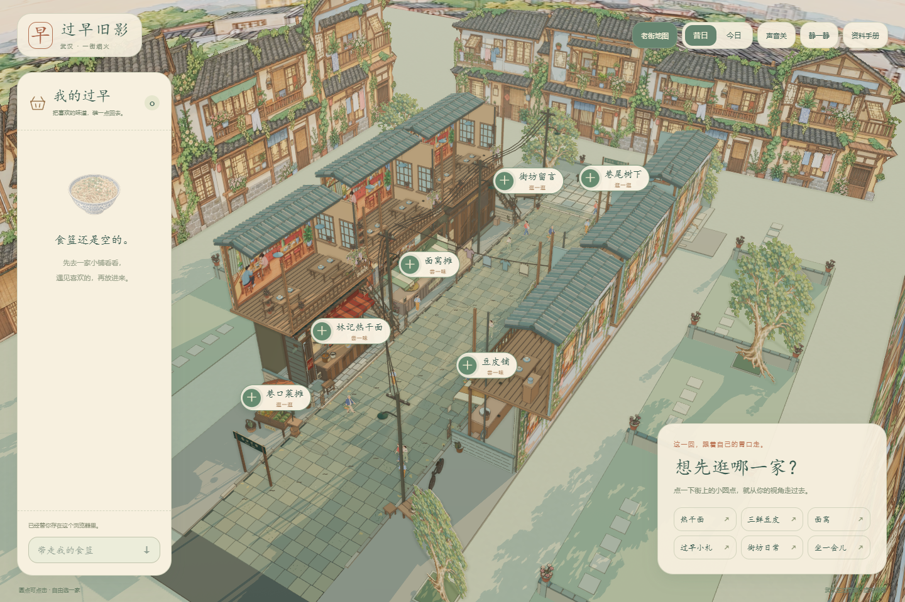
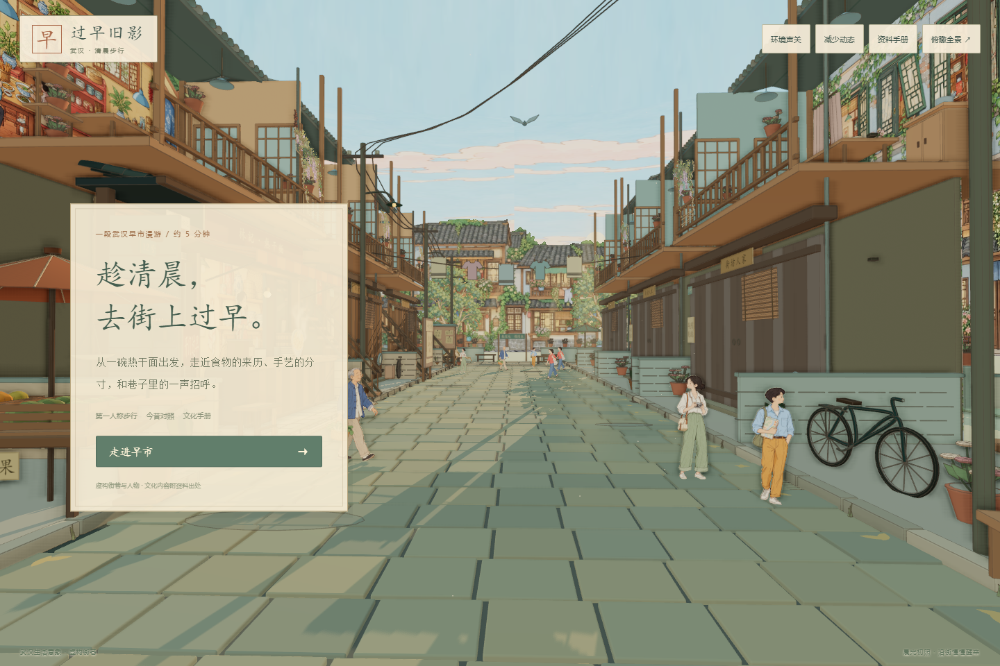
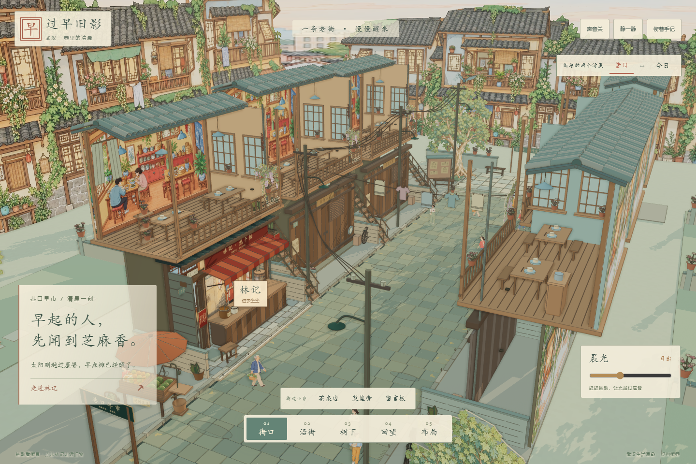
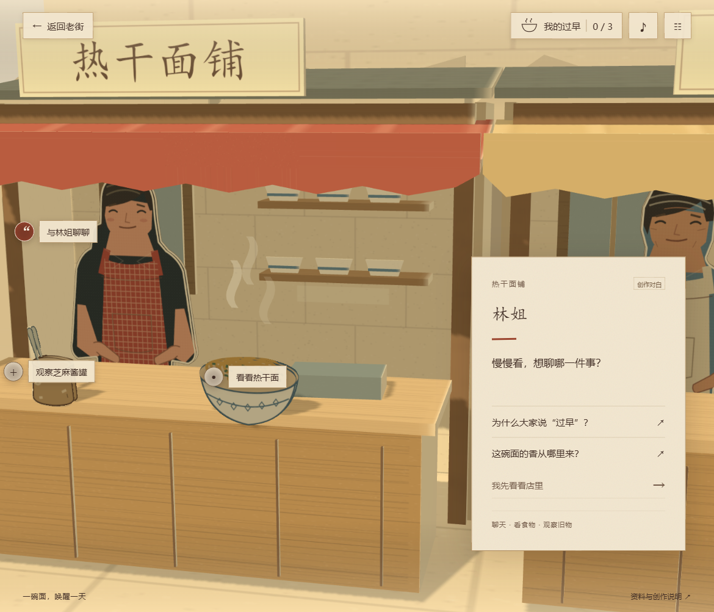

# 过早旧影 · 武汉绘本早市 v7

## 当前版本：自由选店与过早食篮（2026-10-03）

入口 **`/?sample=tour&v=7`**，Windows 运行 `Start-Tour.cmd`。淡彩老街封面 → 地图自由选店 → 第一人称走近 → 阅读文化故事 → 把喜欢的食物放进左侧食篮。六处地点全部可选，没有固定八站顺序。圆角纸面 UI 随今昔换色；三种食物可收藏、移出、回看和下载，刷新保留。

三维街景有日出光影、18 位纸偶、石板与墙面细节。林记是完整翻墙/人物动画样板；豆皮和面窝已有独立体验柜台及背景，尚待补齐各自的两年代素材和人物动画。其余三处店铺仍预留。

**接手顺序：**[开始说明](START-HERE-绘本老街.md) → [可直接发给 Codex 的续做提示词](docs/street/给同学Codex-续做提示词-v7.md) → [v7 实现与范围](docs/street/自由逛街-v7-交接.md)。旧版文档的路线顺序和进度门槛已被 v7 替代，下面保留开发沿革。

公开交接仓库：[Zhu4143/wuhan-breakfast-storybook-handoff](https://github.com/Zhu4143/wuhan-breakfast-storybook-handoff)。完整可预览 ZIP 与 SHA256 校验放在 [v7 交接 Release](https://github.com/Zhu4143/wuhan-breakfast-storybook-handoff/releases/tag/v7.0.0-handoff)。源码仓库不含 `dist` 和 `node_modules`，运行前需要安装依赖/构建；Release 中的完整 ZIP 含 `dist`、源素材、浏览器证据和全部交接文档。此仓库为原项目的独立交接快照，不覆盖同学的原仓库。




## 历史版本：第一人称顺序路线（v6，已被 v7 替代）

新入口 **`/?sample=tour&v=6`**，Windows 可运行 `Start-Tour.cmd`。从巷口沿街步行，经武汉过早、林记、手艺与来历、今昔对照、一街百味、街坊日常，到街尾回望并生成个人手册。支持刷新继续、逐页文化出处、食物记录、今昔换色与缓变晨光。沿用细线淡彩绘本街景，原有入口全部保留。

先读 [新版开始说明](START-HERE-绘本老街.md) 和 [第一人称游览与资料交接](docs/street/第一人称游览与资料-2026-10-03.md)。实现与验收均在本地，尚未推送 GitHub。



## 当前美术与街景：细线淡彩绘本版（2026-10-03，v5）

新入口 **`/?sample=street`**。完整道路、周围民居与庭院、纸偶行人、日出光影、一间林记与五处预留铺位；林记保留今昔翻墙和物品特写。先读 [新版开始说明](START-HERE-绘本老街.md) 与 [街景/画风交接](docs/street/街景与画风交接-2026-10-03.md)。用户选定的新参考已取代 v3 的写实纸板美术方向。此次变更仍在本地，尚未推送 GitHub。

增加三个可走近观察的生活角落：茶桌、菜摊、留言板，各有昔日与今日的陈设和文案。楼上有折面窗帘、花架、碗柜与晾椒，路沿有落叶和砖缝植物。五个店铺预留位置不变。



## 新增：林记精细纸景样板（2026-10-02 v3）

运行开发服务后访问 `/?sample=noodle`，体验一间热干面铺的昔日/今日切换、两代店主、旧物阅读、纸层展开与轻动效。原来的完整故事仍位于 `/`。

继续复刻或扩展时，先读 [v3 升级说明](docs/atelier/升级说明-v3-2026-10-02.md) 和 [给接手 Codex 的说明](docs/atelier/README-给接手的Codex.md)。本地样板已补齐翻墙动画、人物六帧来源、面上热气、年代界面和接触光影；原图、提示词、实际浏览器截图和验收脚本均已包含。v3 尚未推送到远端。

走进一张照片，听见武汉的清晨。React、TypeScript、Three.js、GSAP 与 Vite 实现的本地交互叙事，已按 2026-09-30 的纸景方向接入三家早餐铺。



公开源码：[GEMING-eng/wuhan-breakfast-paper-stage](https://github.com/GEMING-eng/wuhan-breakfast-paper-stage)。无需登录即可查看与下载。

## 立即预览

下载 [v1.1 完整实施包](https://github.com/GEMING-eng/wuhan-breakfast-paper-stage/releases/tag/v1.1.0)，解压后目录中已提供 `dist/` 构建。Windows 双击 `Start-Preview.cmd`，打开终端显示的 `http://127.0.0.1:4173/`。需要 Node.js 22.18 或以上版本；这台开发机器使用 Node 24.19。预览不需要安装 npm 依赖，也不需要联网。

从 GitHub 的 Code 按钮下载或克隆的是源码，需要按下一节安装依赖、构建后再预览。`dist` 与 `node_modules` 不进入源码提交。仓库与发布包公开可访问；网站目前通过本地服务运行。

**不要直接双击 dist/index.html**：ES 模块与资源须通过本地 HTTP 服务读取。退出终端或 Ctrl+C 可停止服务。

## 继续开发

```powershell
npm.cmd ci
npm.cmd run dev
npm.cmd test
npm.cmd run build
npm.cmd run preview
```

开发入口通常是 `http://127.0.0.1:5173/`。构建使用相对 base path，可放在静态服务的子目录。没有后端、账号、在线 AI 对话、支付或远程美术依赖。

## 体验与实现

- 新体验：相册对白 → 拿起照片 → 展开纸层并推进镜头 → 任意顺序进入三家店。
- 每家店有两条基础话题、一件可观察旧物和观察后解锁的追问。读完追问末句才生成记忆；看过物件不会误算完成。
- 允许提前回到今天，再继续探索；三条记忆齐备后可以回望照片并进入完整结尾。
- 进度只写入本项目键 `wuhan-breakfast-story.save.v1`。刷新恢复稳定对白节点；重新开始需确认，保留声音与阅读设置。
- 每间店用真实几何搭建：纸板地面、后墙、带门洞的框架、折面雨棚、盒状柜台、分层货架、轮廓纸偶、纸片食物与器物。小凳由座面、四条腿和横撑组成。灯光产生空间投影，场景不是一张整图。
- 一套 WebGL renderer，桌面、手机横屏与竖屏使用不同相机预设。旧物观察靠近同一模型，热点由世界坐标投影并做遮挡检查。
- 照片来自同一历史纸景的固定镜头渲染。入口同步 HTML 相纸边框、真实纸层展开和相机推进；支持跳过与简化动效。
- 提供静音、音量、简化动效、直接显示对白和低性能模式。低性能模式保留几何纸层，降低像素比并关闭阴影、蒸汽。上下文丢失有提示、恢复和重试入口。

## 目录

| 位置 | 内容 |
|---|---|
| `src/content/` | 完整对白、店铺与事实来源数据、现行素材清单 |
| `src/app/` | 状态机、持久化、页面与覆盖层 |
| `src/scene3d/` | 几何、材质、相机、投影与命中、渲染生命周期 |
| `public/assets/` | 12 件原创 SVG 图案、同景照片、原创合成 WAV |
| `tools/` | 美术/音频生成程序、静态预览、开发验收导出 |
| `docs/verification/` | 页面和纸景截图及实际视口、相机、状态记录 |
| `docs/legacy-art/` | 保留的旧整图方案与原平面渲染组件，仅作参考 |
| `tests/` | 内容与状态机、存档、三维命中和相机验证 |

开发时访问 `?review=1` 可使用本地验收面板，导出截图、模拟 WebGL 丢失与存储失败。它不进入正式构建；验收导出服务只由 Vite 的本地开发服务提供。

## 验证与边界

实际页面已完成三店观察、追问、三条记忆、照片回望与完整结尾；也验证了部分结尾、刷新继续、长菜单、Esc 关闭、低性能和真实 WebGL 上下文恢复。具体证据与未覆盖范围见 [验收记录](docs/verification/README.md)。

手机验证为浏览器模拟尺寸，**未做真实手机测试**；不承诺所有设备满帧。声音是合成环境与选择声，没有真人配音。纸偶造型是本版原创矢量美术，后续可以在同一几何轮廓与尺寸规范内继续精修。

本作依据武汉饮食文化资料进行艺术化演绎，街段与人物为虚构，不是某一历史地点的精确复原。资料页区分资料、创作对白与主题归纳；未复制馆藏照片或网络摄影。参见 [素材与交接说明](docs/交接说明.md) 和 `src/content/sources.ts`。
